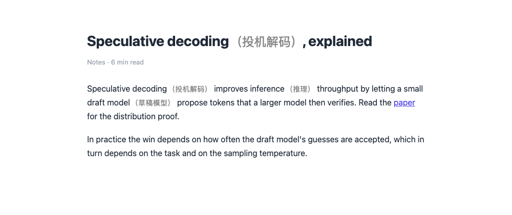
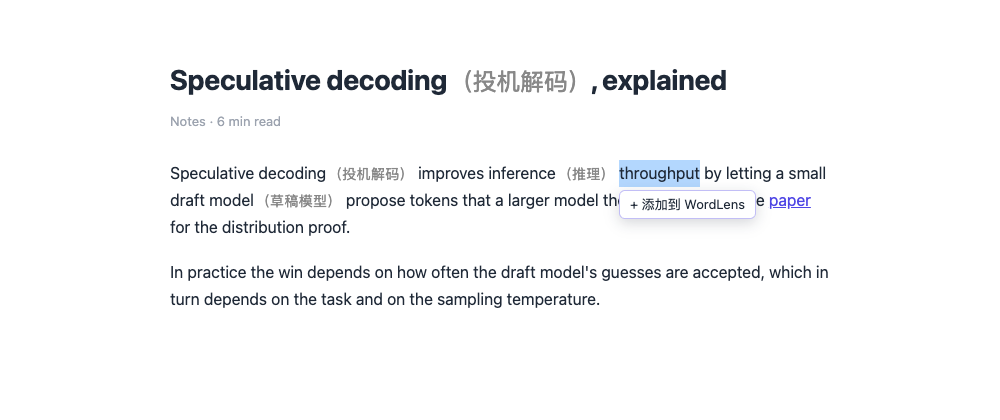
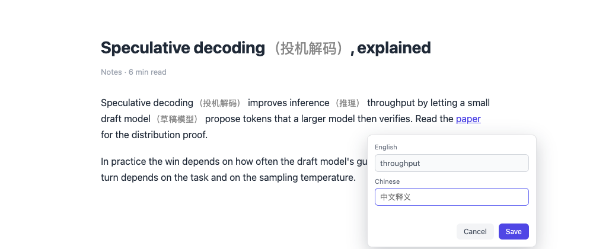
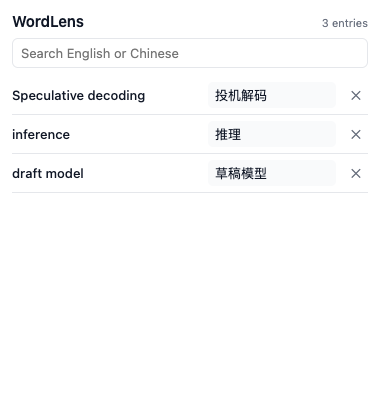

<p align="center">
  
</p>

<h1 align="center">WordLens</h1>

<p align="center">
  <b>Write the Chinese meaning of an English word once — see it next to that word on every page you read.</b>
</p>

<p align="center">
  <a href="https://github.com/lxbworld/wordlens/releases/latest"><b>⬇ Download &amp; install</b></a>
  ·
  <a href="README.zh-CN.md">中文说明</a>
  ·
  <a href="#how-it-works">How it works</a>
  ·
  <a href="#known-limits">Limits</a>
</p>

<p align="center">
  <a href="https://github.com/lxbworld/wordlens/actions/workflows/ci.yml"></a>
  
</p>



No account, no server, no AI, no network requests. Your glossary stays in your browser.

---

## Install — about a minute, no terminal

**1. Download the zip** → [latest release](https://github.com/lxbworld/wordlens/releases/latest) → unzip it. You get a folder called `wordlens`.

**2. Open Chrome's extension page** → type `chrome://extensions` in the address bar.

**3. Turn on `Developer mode`** (top-right switch), then click **`Load unpacked`** and choose the unzipped `wordlens` folder.

That's it. Click the puzzle-piece icon in the toolbar and **pin WordLens** so its dictionary is always one click away.

> Seeing a "Disable developer mode extensions" warning when Chrome starts? Normal for unpacked extensions — click *Keep*. WordLens requests a single permission (`storage`) and never talks to the internet.
>
> Using Edge or Brave? Same steps at `edge://extensions` / `brave://extensions`.

---

## Use it — 20 seconds

**1. Select an English word or phrase** on any page — drag with the mouse, or hold `Shift` and use the arrow keys.



**2. Click `+ 添加到 WordLens`, type the Chinese meaning, hit `Save`.**



**3. Done.** The page is annotated immediately — and so is every page you open later that contains the word:

> `speculative decoding` → `speculative decoding（投机解码）`

Click the WordLens icon whenever you want to **search**, **fix a meaning** or **delete** an entry. Changes reach pages that are already open, without reloading them.



### What gets annotated

- Any term you saved: single words (`inference`) and phrases (`speculative decoding`).
- Case doesn't matter: `Inference`, `INFERENCE` and `inference` all match; the page keeps its own capitalisation.
- Whole words only: saving `art` never touches `article` or `partial`.
- The gloss is added in brackets after the original text, so the sentence still reads normally:
  `speculative decoding（投机解码）`.
- Links, buttons and page layout keep working — WordLens adds a tiny `<span>`, it never rewrites the page's HTML.
- Pages that load content later (infinite scroll, single-page apps) get annotated as the content appears.

---

## Questions people actually ask

| What you see | What's going on |
| --- | --- |
| Nothing happens after installing | Reload the page you're on — extensions start working on the next page load. |
| A page is never annotated | Chrome-internal pages (`chrome://…`), the Web Store and the built-in PDF viewer can't be modified by any extension. Normal websites only. |
| I saved `model` but `models` isn't annotated | Matching is literal. Save `models` as a separate entry. |
| The button says something in Chinese | The toolbar and editor strings are Chinese (`+ 添加到 WordLens`, `中文释义`); the dictionary itself accepts English and Chinese. |
| My words disappeared | The dictionary lives in `chrome.storage.local` on this machine. Uninstalling the extension or clearing its data deletes it — there's no export or sync yet. |
| I want to start over | Remove entries with ✕ in the popup, or remove and re-add the extension. |

---

## How it works

<details>
<summary>For the curious and for contributors</summary>

- **Storage** — one versioned document in `chrome.storage.local` (`{ version: 1, entries: [...] }`) behind a `DictionaryRepository` (`getAll` · `findByTerm` · `add` · `update` · `delete` · `subscribe`), with uniqueness checks, corrupt-data repair and storage-error handling.
- **Matching** — all terms compile into one alternation regex, longest term first, wrapped in word-boundary lookarounds. Scanning left to right gives longest-match-wins, case-insensitive, non-overlapping hits in a single pass, with UTF-16 indices that map straight onto `Text.data.slice`.
- **Annotation** — a `TreeWalker` snapshots text nodes (skipping `script`, `style`, `code`, `pre`, form controls, SVG, canvas, `contenteditable` and WordLens' own nodes), then each hit is split into `text + <span class="wordlens-annotation">（译文）</span> + text` with a `DocumentFragment`. No `innerHTML`, no layout changes.
- **Dynamic pages** — a `MutationObserver` batches new nodes into one animation frame and ignores WordLens' own insertions, so SPA re-renders and infinite scroll are covered without rescanning the whole page.
- **UI** — the selection toolbar and editor live in a shadow root (page CSS can't reach them); the popup is plain HTML/CSS/TypeScript.

```
public/      manifest.json + icons
src/core/    types, normalizer, validation, repository, matcher
src/content/ scanner, renderer, annotation engine, selection toolbar, observer
src/popup/   dictionary UI
src/styles/  annotation.css
tests/       unit tests + tests/e2e (real Chromium)
```

</details>

## Build from source

```bash
npm install
npm run build     # writes dist/
# then load dist/ as an unpacked extension
```

| Command | What it does |
| --- | --- |
| `npm run dev` | Rebuild both bundles on change (reload the extension to apply) |
| `npm test` | Unit tests (vitest + jsdom) |
| `npm run test:e2e` | Full flow in a real Chromium: select → save → annotate → reload → other site → edit → delete |
| `npm run typecheck` | `tsc --noEmit` |
| `npm run screenshots` | Regenerate the images in `docs/` |

`npm run test:e2e` needs a Chromium that accepts `--load-extension`: run `npx playwright install chromium`, or point at any Chromium/Chrome-for-Testing binary with `WORDLENS_CHROME_PATH=/path/to/chrome`. Branded Google Chrome refuses that flag, so the suite uses a bundled Chromium.

## Known limits

- **No lemmatisation** — `model` does not match `models`; add each form you care about.
- **One text node per match** — a phrase split by markup (`<span>speculative</span> <b>decoding</b>`) isn't matched yet.
- **Latin terms only** — English letters, digits and punctuation that occurs inside terms (`-`, `'`, `.`, `/`, `+`, `#`, `&`, `:`).
- **Hyphens and apostrophes count as word characters** — `art` doesn't match `art-house` or `art's`.
- **Local only** — no sync between browsers, no export/import.
- **Not included on purpose** — built-in dictionaries, auto-translation, LLM calls, word-form recognition, FSRS/Anki, TTS, accounts, cloud sync.

## License

MIT — see [LICENSE](LICENSE).
