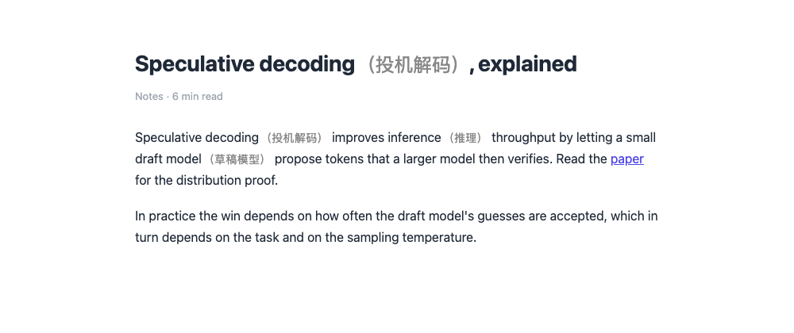
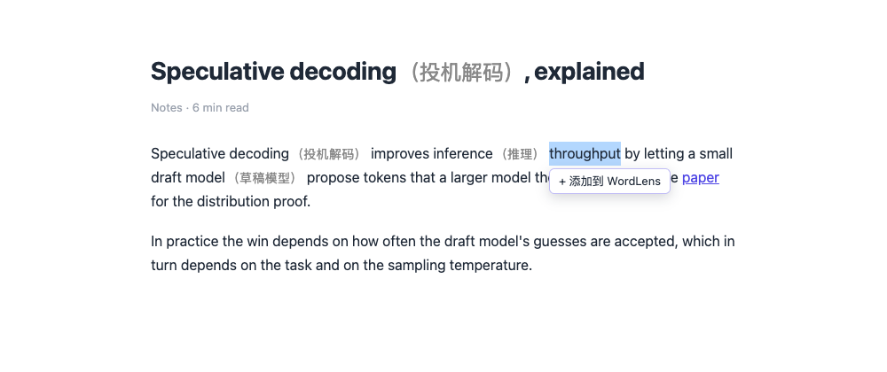
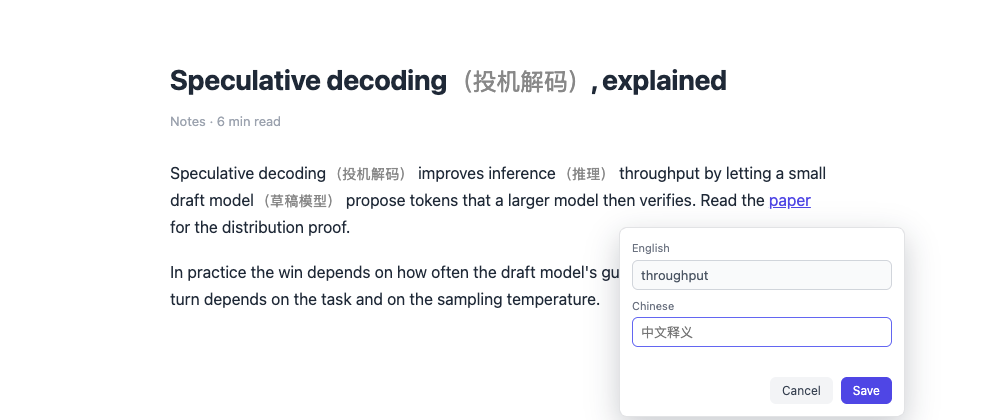
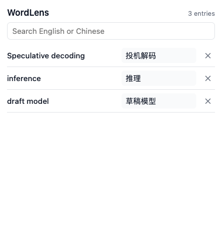

<p align="center">
  
</p>

<h1 align="center">WordLens</h1>

<p align="center">
  <b>英文生词的中文意思只填一次，之后每个网页上它旁边都会自动带出来。</b>
</p>

<p align="center">
  <a href="https://github.com/lxbworld/wordlens/releases/latest"><b>⬇ 下载安装</b></a>
  ·
  <a href="README.md">English</a>
  ·
  <a href="#原理">原理</a>
  ·
  <a href="#已知限制">限制</a>
</p>

<p align="center">
  <a href="https://github.com/lxbworld/wordlens/actions/workflows/ci.yml"></a>
  
</p>



不用注册、不用服务器、不调用任何 AI，也不联网。词库只存在你自己的浏览器里。

---

## 安装 —— 一分钟，不用命令行

**1. 下载压缩包** → [最新版本](https://github.com/lxbworld/wordlens/releases/latest) → 解压，得到一个 `wordlens` 文件夹。

**2. 打开扩展页** → 地址栏输入 `chrome://extensions`。

**3. 打开右上角的 `开发者模式`**，点 **`加载已解压的扩展程序`**，选中刚解压的 `wordlens` 文件夹。

装好了。点工具栏的拼图图标，把 **WordLens 固定**出来，以后管理词库一键可达。

> Chrome 启动时提示"停用开发者模式扩展"？解压安装的扩展都会这样，点 *保留* 即可。WordLens 只申请 `storage` 一个权限，不联网。
>
> 用 Edge / Brave？把地址换成 `edge://extensions` / `brave://extensions`，步骤一样。

---

## 20 秒上手

**1. 在任意网页上选中一个英文单词或短语** —— 鼠标拖选，或按住 `Shift` 配合方向键。



**2. 点 `+ 添加到 WordLens`，填中文释义，按 `Save`。**



**3. 完成。** 当前页面立刻注释，以后打开的页面出现同一个词也一样：

> `speculative decoding` → `speculative decoding（投机解码）`

点工具栏的 WordLens 图标，随时可以**搜索**、**改释义**、**删词条**。改动对已经打开的页面也立即生效，不用刷新。



### 什么样的词会被注释

- 你存过的任何词条：单词（`inference`）和短语（`speculative decoding`）都行。
- **不分大小写**：`Inference`、`INFERENCE`、`inference` 都命中，网页原有的大小写不变。
- **只匹配整词**：存了 `art`，不会误伤 `article`、`partial`。
- 注释以括号形式跟在原文后面，句子照常读：`speculative decoding（投机解码）`。
- 链接、按钮、排版都不受影响 —— 只在原文后面插一个 `<span>`，绝不重写网页 HTML。
- 滚动加载、单页应用后插入的内容，也会自动注释。

---

## 常见问题

| 你遇到的 | 原因 / 怎么办 |
| --- | --- |
| 装完什么都没发生 | 刷新一下当前网页。扩展从下一个页面开始生效。 |
| 某个页面完全没注释 | `chrome://` 开头的浏览器内部页、Chrome 应用商店、内置 PDF 阅读器，任何扩展都改不了，普通网站才行。 |
| 存了 `model`，`models` 却没注释 | 匹配是字面匹配，不做词形还原。把 `models` 单独加一条。 |
| 按钮上是中文 | 交互文案是中文（`+ 添加到 WordLens`、`中文释义`、`Save`/`Cancel`），词库本身中英文都能搜。 |
| 词库空了 / 丢词了 | 词库存在本机 `chrome.storage.local`。卸载扩展或清除扩展数据就会删掉，目前没有导出和同步。 |
| 想清空重来 | 在弹窗里逐条点 ✕，或者卸载后重新加载扩展。 |

---

## 原理

<details>
<summary>给好奇的人和贡献者</summary>

- **存储**：`chrome.storage.local` 里一个带版本号的文档（`{ version: 1, entries: [...] }`），由 `DictionaryRepository`（`getAll` · `findByTerm` · `add` · `update` · `delete` · `subscribe`）封装，含唯一性校验、损坏数据修复、写入失败处理。
- **匹配**：所有词条编译成一个正则，长词在前，两侧加单词边界断言；从左到右扫描一遍即得到「最长优先、不分大小写、互不重叠」的结果，下标是 UTF-16 偏移，可直接对 `Text.data.slice`。
- **注释**：`TreeWalker` 先快照文本节点（跳过 `script`/`style`/`code`/`pre`/表单控件/SVG/canvas/`contenteditable` 和自己生成的节点），再对每个命中节点用 `DocumentFragment` 拆成 `原文 + <span class="wordlens-annotation">（译文）</span> + 原文`。不用 `innerHTML`，不改变布局。
- **动态页面**：`MutationObserver` 把新节点按帧批处理，并忽略自己造成的变更，所以 SPA 重渲染、无限滚动都能覆盖，且不会整页重扫。
- **界面**：选词按钮和编辑框在 shadow root 里（网页 CSS 影响不到），弹窗是原生 HTML/CSS/TypeScript。

```
public/      manifest.json + 图标
src/core/    类型、规范化、校验、词库、匹配器
src/content/ 扫描器、渲染器、注释引擎、选词工具条、观察器
src/popup/   词库管理界面
src/styles/  annotation.css
tests/       单元测试 + tests/e2e（真实 Chromium）
```

</details>

## 从源码构建

```bash
npm install
npm run build        # 产出 dist/
# 然后把 dist/ 当作「已解压的扩展程序」加载
```

| 命令 | 作用 |
| --- | --- |
| `npm run dev` | 改代码后自动重建（重建后要在扩展页点"重新加载"） |
| `npm test` | 单元测试（vitest + jsdom） |
| `npm run test:e2e` | 真实 Chromium 里跑完整流程：选中 → 保存 → 注释 → 刷新 → 换站点 → 改 → 删 |
| `npm run typecheck` | `tsc --noEmit` |
| `npm run screenshots` | 重新生成 `docs/` 里的配图 |

`npm run test:e2e` 需要一个接受 `--load-extension` 的 Chromium：先 `npx playwright install chromium`，或用 `WORDLENS_CHROME_PATH=/path/to/chrome` 指向任意 Chromium / Chrome for Testing。正式版 Chrome 已经拒绝这个参数，所以测试默认用自带的 Chromium。

## 已知限制

- **不做词形还原**：`model` 不会匹配 `models`，需要的词形请各自添加。
- **只在单个文本节点内匹配**：被标签拆开的短语（`<span>speculative</span> <b>decoding</b>`）暂不支持。
- **只支持拉丁字母词条**：允许英文字母、数字，以及词内部会出现的标点（`-` `'` `.` `/` `+` `#` `&` `:`）。
- **连字符和撇号算作词字**：存了 `art`，不会命中 `art-house` 或 `art's`。
- **纯本地**：浏览器之间不同步，没有导出/导入。
- **故意不做**：内置词典、自动/LLM 翻译、词形识别、FSRS/Anki、发音朗读、账号、云同步。

## License

MIT，见 [LICENSE](LICENSE)。
